# Real-Time Air Quality Data Pipeline

A complete end-to-end data engineering project that monitors air quality in real-time for Kenyan cities (Nairobi and Mombasa), demonstrating modern data pipeline architecture using streaming, change data capture (CDC), and analytics storage.

---

## Table of Contents

1. [Project Overview](#project-overview)
2. [Architecture Overview](#architecture-overview)
3. [Technologies Used](#technologies-used)
4. [Prerequisites](#prerequisites)
5. [Quick Start](#quick-start)
6. [Understanding the Data Flow](#understanding-the-data-flow)
7. [Monitoring & Dashboards](#monitoring--dashboards)
8. [Querying the Data](#querying-the-data)
9. [Troubleshooting](#troubleshooting)
10. [Future Enhancements](#future-enhancements)

---

## Project Overview

This project builds a **real-time data pipeline** that:
- Collects air quality data (PM2.5, PM10, CO, NO2, SO2, Ozone, UV Index) every hour
- Streams data through Kafka message queue
- Stores raw data in MongoDB
- Captures changes automatically using CDC (Change Data Capture)
- Stores processed data in Cassandra for fast analytics

**Key Features:**
- Fully automated data collection (hourly schedule)
- Real-time data streaming with Apache Kafka
- Change Data Capture with Debezium
- Multiple storage systems optimized for different use cases
- Built-in monitoring dashboards
- Production-ready error handling and retry logic
- Fully containerized with Docker

---

## Architecture Overview

```
┌─────────────────┐
│   Open-Meteo    │  External Air Quality API
│      API        │
└────────┬────────┘
         │ HTTP (hourly)
         ↓
┌─────────────────┐
│    Producer     │  Python script (data ingestion)
└────────┬────────┘
         │ Publish
         ↓
┌─────────────────┐
│  Kafka Broker   │  Message queue
│  (air_quality_  │
│      data)      │
└────────┬────────┘
         │ Subscribe
         ↓
┌─────────────────┐
│    Consumer     │  MongoDB writer
└────────┬────────┘
         │ Insert
         ↓
┌─────────────────┐
│    MongoDB      │  Raw data storage (Replica Set)
│ (air_quality_   │
│      raw)       │
└────────┬────────┘
         │ Monitor changes
         ↓
┌─────────────────┐
│    Debezium     │  Change Data Capture (CDC)
│   Connector     │
└────────┬────────┘
         │ Publish changes
         ↓
┌─────────────────┐
│     Kafka       │  CDC topic
│  (mongo_cdc.    │
│ air_quality_db) │
└────────┬────────┘
         │ Subscribe
         ↓
┌─────────────────┐
│   Cassandra     │  Analytics storage
│   Consumer      │
└────────┬────────┘
         │ Insert
         ↓
┌─────────────────┐
│   Cassandra     │  Time-series analytics
│ (air_quality_   │
│   readings)     │
└─────────────────┘
```

---

## Technologies Used

| Technology | Purpose | Why We Use It |
|------------|---------|---------------|
| **Python** | Data ingestion & processing | Easy API integration, rich libraries |
| **Apache Kafka** | Message streaming | Handles high-throughput data streams |
| **MongoDB** | Raw data storage | Flexible schema for semi-structured data |
| **Debezium** | Change Data Capture | Automatically tracks database changes |
| **Cassandra** | Analytics storage | Fast time-series queries at scale |
| **Docker** | Containerization | Consistent environments, easy deployment |
| **Zookeeper** | Kafka coordination | Manages Kafka cluster metadata |

**Python Libraries:**
- `kafka-python` - Kafka producer/consumer
- `pymongo` - MongoDB driver
- `cassandra-driver` - Cassandra driver
- `requests` - HTTP API calls
- `python-dotenv` - Environment variable management

---

## Prerequisites

- **Docker** (v20.10+) and **Docker Compose** (v2.0+)
- **Python 3.10+** (for local development)
- **4GB RAM minimum** (8GB recommended)
- **10GB free disk space**
- **Internet connection** (to fetch air quality data)

**Verify installation:**
```bash
docker --version
docker-compose --version
python3 --version
```

---

## Quick Start

### 1. Clone the Repository
```bash
git clone https://github.com/yourusername/air-quality-pipeline.git
cd air-quality-pipeline
```

### 2. Create Environment File
```bash
cp .env
```

**Edit `.env` if needed** (default values work out of the box):
```env
# Kafka Configuration
BOOTSTRAP_SERVERS=kafka:9092
KAFKA_TOPIC=air_quality_data

# MongoDB Configuration
MONGO_HOST=mongo
MONGO_PORT=27017
MONGO_USER=airflow
MONGO_PASSWORD=airflow123

# Cassandra Configuration
CASSANDRA_HOST=Cassandra
CASSANDRA_PORT=9042

# Data Collection
FETCH_INTERVAL=3600  # 1 hour in seconds
OPEN_METEO_URL=https://air-quality-api.open-meteo.com/v1/air-quality
```

### 3. Create MongoDB Keyfile
```bash
openssl rand -base64 756 > mongo-keyfile
chmod 400 mongo-keyfile
sudo chown 999:999 mongo-keyfile  # MongoDB user ID in Docker
```

### 4. Start All Services
```bash
docker-compose up -d
```

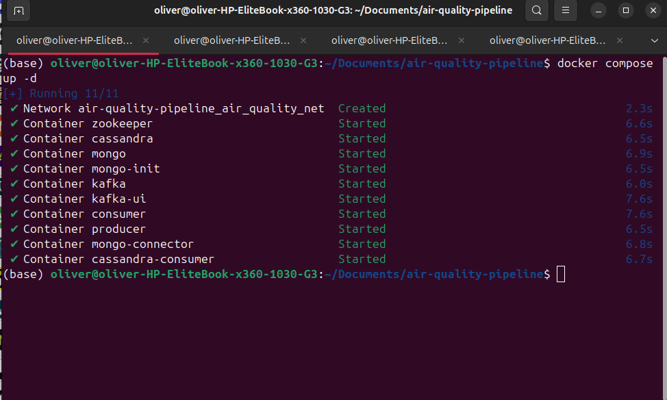
*Docker Compose pulling images and starting all services*

**Wait 2-3 minutes** for all services to start, then verify:
```bash
docker ps
```

You should see 9 containers running:
- `mongo`, `mongo-init`
- `zookeeper`, `kafka`, `kafka-ui`
- `mongo-connector`
- `producer`, `consumer`, `cassandra-consumer`
- `cassandra`

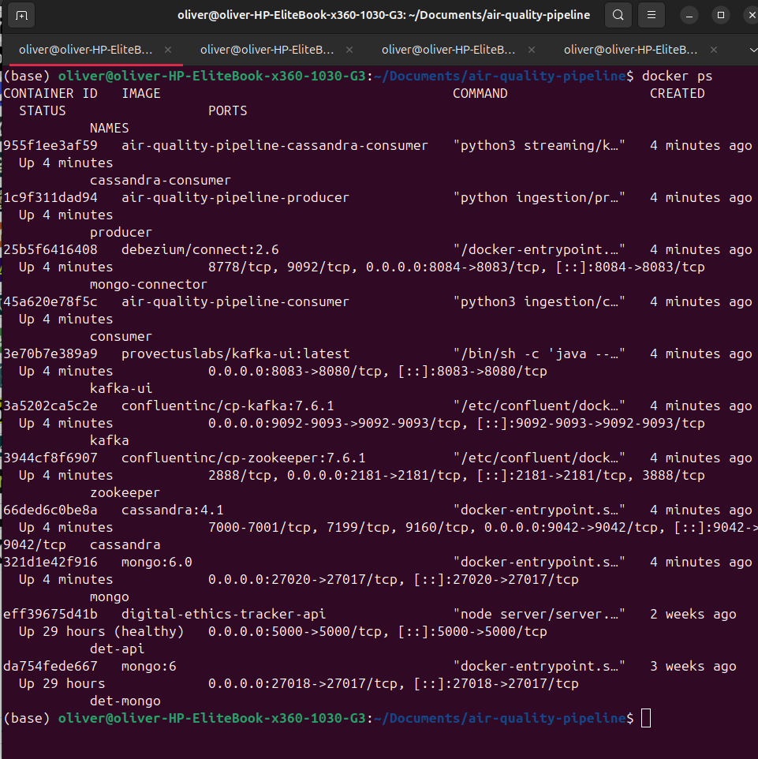
*All 9 containers running - verify with docker ps*

### 5. Initialize MongoDB Replica Set
```bash
bash storage/init-replica-set.sh
```

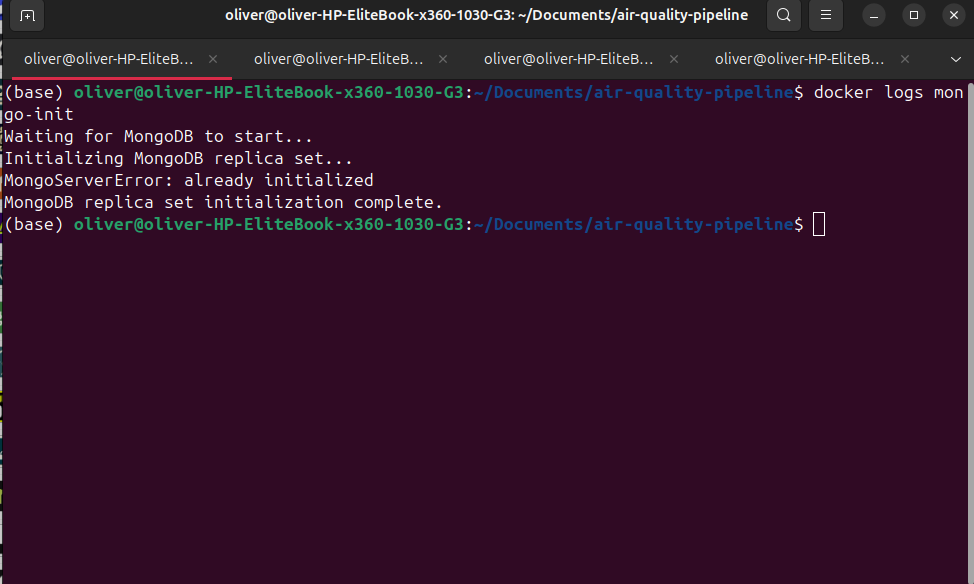
*MongoDB replica set initialized successfully*

### 6. Initialize Cassandra Schema
```bash
docker exec -i cassandra cqlsh < storage/cassandra_setup.cql
```

### 7. Register Debezium CDC Connector
```bash
bash streaming/register-connector.sh
```

### 8. Verify Everything is Running
```bash
bash health-check.sh
```
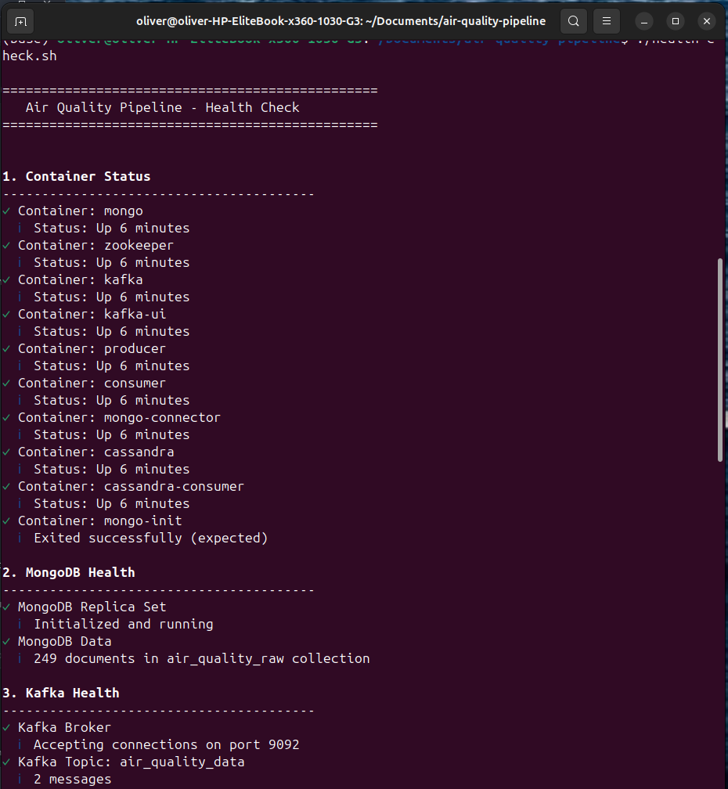

---

## Understanding the Data Flow

### How Data Moves Through the Pipeline

**Step 1: Producer Fetches Data (Every Hour)**
- Producer calls Open-Meteo API for Nairobi and Mombasa
- Requests last 24 hours of historical data with `forecast_days=0`
- Selects the most recent hour with complete (non-null) data
- Publishes to Kafka topic `air_quality_data`

**Important:** The producer fetches **actual historical data**, not forecasts. It searches backwards through the API response to find the most recent hour with all pollutant values populated.

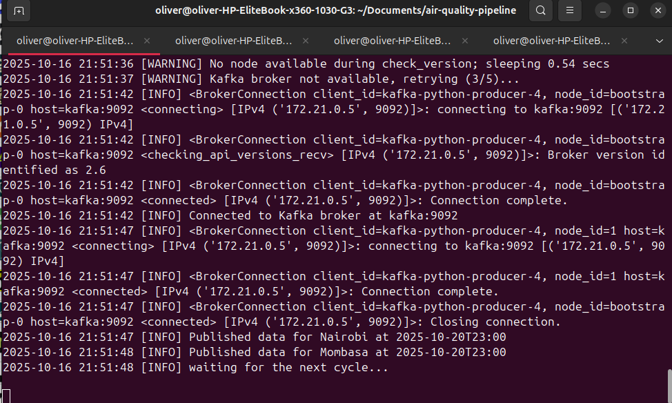
*Producer logs showing successful data fetching and publishing to Kafka*

**Step 2: Consumer Writes to MongoDB**
- Consumer reads from Kafka topic
- Inserts raw data into MongoDB collection `air_quality_raw`
- MongoDB stores complete JSON document with all fields

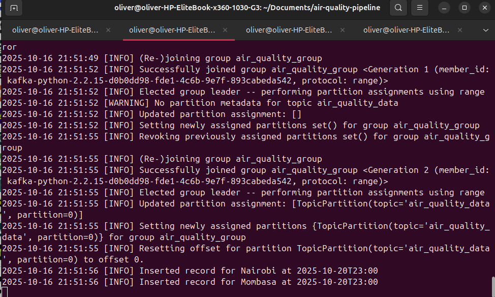
*Consumer logs showing records inserted into MongoDB*

**Step 3: Debezium Captures Changes**
- Debezium monitors MongoDB replica set
- Automatically detects new documents
- Publishes change events to CDC topic `mongo_cdc.air_quality_db.air_quality_raw`

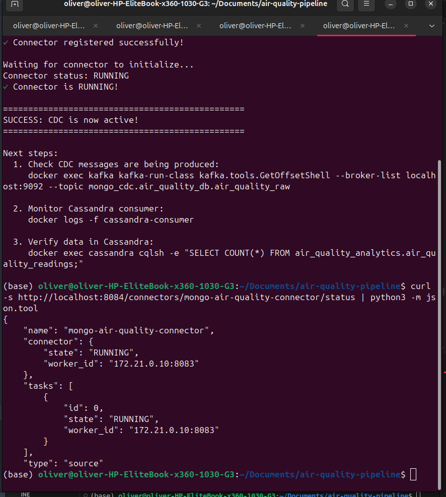
*Debezium connector registered and running*

**Step 4: Cassandra Consumer Processes CDC Events**
- Reads from CDC topic
- Validates data (skips records with None values)
- Inserts into Cassandra table `air_quality_readings`

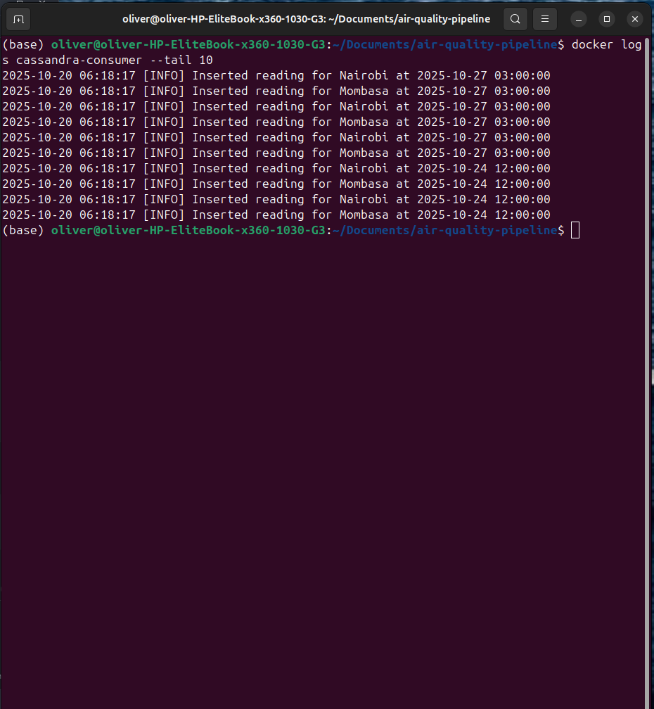
```bash
docker logs cassandra-consumer --tail 20
```
*Show: "Inserted reading for Nairobi at..." messages*

**Step 5: Data Ready for Analytics**
- Cassandra stores time-series data optimized for queries
- Two timestamps tracked:
  - `timestamp`: The hour the air quality reading represents (from API data)
  - `inserted_at`: When the record was inserted (system time)

---

## Monitoring & Dashboards

### Kafka UI
**Access:** http://localhost:8083

Monitor Kafka topics, messages, and consumers:
- View messages in `air_quality_data` topic
- Check CDC events in `mongo_cdc.air_quality_db.air_quality_raw`
- Monitor consumer lag

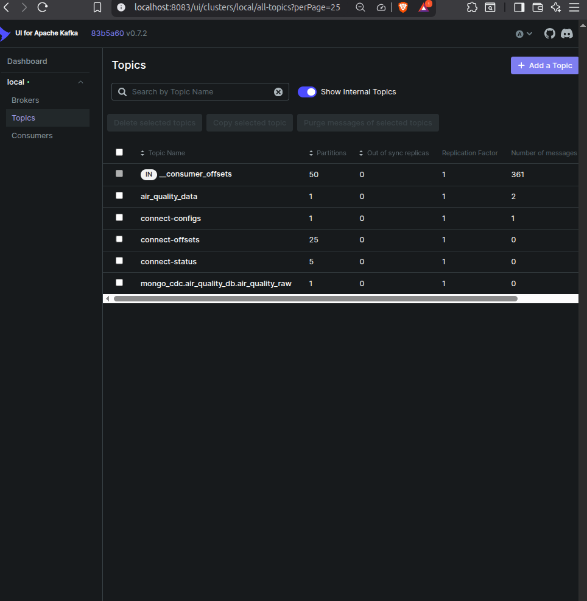
*Kafka UI showing topics and overview*

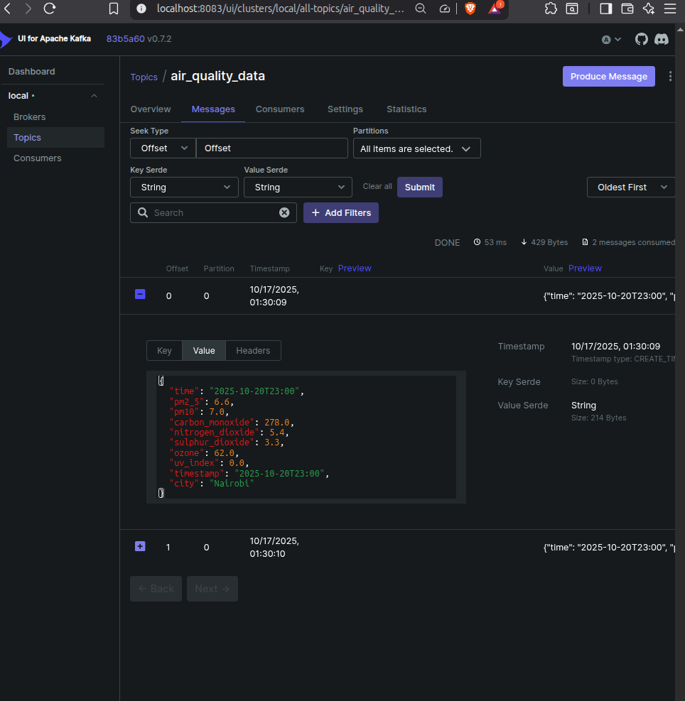
*Messages in air_quality_data topic*

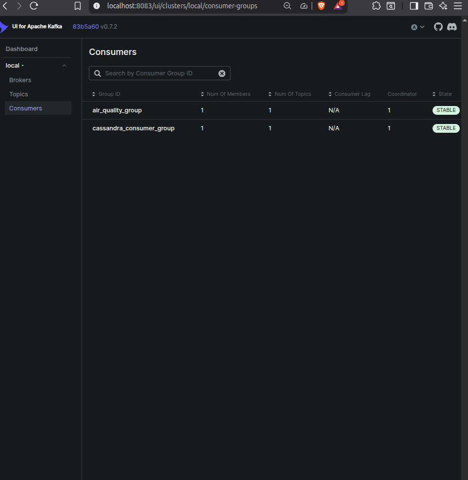
*Consumer groups and their status*

### Kafka Connect API
**Check Debezium connector status:**
```bash
curl -s http://localhost:8084/connectors/mongo-air-quality-connector/status | python3 -m json.tool
```

Expected output:
```json
{
    "name": "mongo-air-quality-connector",
    "connector": {
        "state": "RUNNING",
        "worker_id": "..."
    },
    "tasks": [
        {
            "id": 0,
            "state": "RUNNING",
            "worker_id": "..."
        }
    ]
}
```


*Debezium connector status showing RUNNING state*

---

## Querying the Data

### MongoDB (Raw Data)
```bash
# Connect to MongoDB
docker exec -it mongo mongosh -u airflow -p airflow123 --authenticationDatabase admin

# Switch to database
use air_quality_db

# Count documents
db.air_quality_raw.countDocuments()

# View latest 5 records
db.air_quality_raw.find().sort({_id: -1}).limit(5)

# Query specific city
db.air_quality_raw.find({city: "Nairobi"}).limit(5)
```

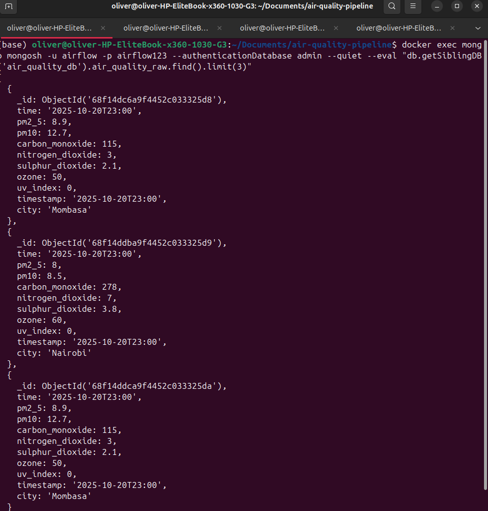
*MongoDB raw data with PM2.5, PM10, ozone, and other pollutant measurements*

### Cassandra (Analytics)
```bash
# Connect to Cassandra
docker exec -it cassandra cqlsh

# View all readings for a city
SELECT city, timestamp, inserted_at, pm2_5, pm10, ozone 
FROM air_quality_analytics.air_quality_readings 
WHERE city='Nairobi';

# Count total readings
SELECT COUNT(*) FROM air_quality_analytics.air_quality_readings;

# View recent readings (by city)
SELECT * FROM air_quality_analytics.air_quality_readings 
WHERE city='Mombasa' 
LIMIT 10;
```

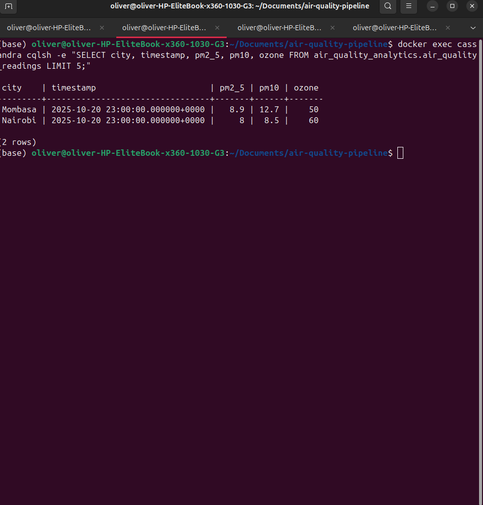
*Cassandra data showing city, timestamp, and air quality measurements*

### Understanding the Timestamps

When you see log output like:
```
2025-10-20 04:34:27 [INFO] Inserted reading for Nairobi at 2025-10-24 12:00:00
```

- **First timestamp** (`2025-10-20 04:34:27`): System time when insertion happened
- **Second timestamp** (`2025-10-24 12:00:00`): Data timestamp - the hour this air quality measurement represents

The data timestamp may be a few days ahead of the current date due to API data availability and timezone handling.

---

## Troubleshooting

### Check Container Logs
```bash
docker logs producer          # Producer logs
docker logs consumer          # MongoDB consumer logs
docker logs cassandra-consumer # Cassandra consumer logs
docker logs mongo-connector   # Debezium CDC logs
```
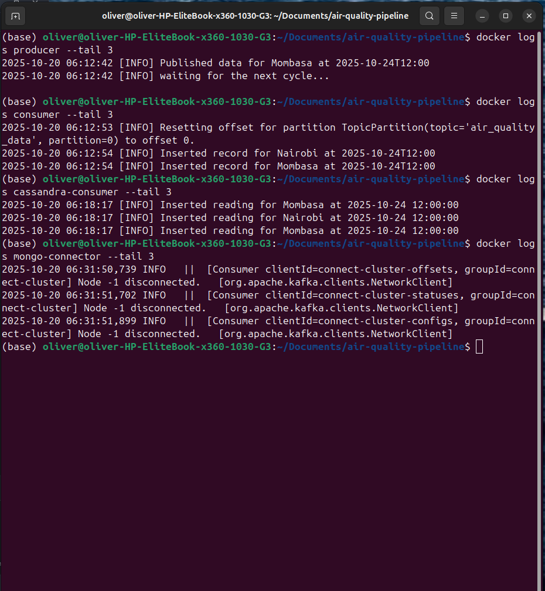

### Common Issues

**Issue 1: MongoDB Replica Set Not Initialized**
```bash
# Error: "not master and slaveOk=false"
# Fix:
bash storage/init-replica-set.sh
```

**Issue 2: Debezium Connector Not Registered**
```bash
# Check if connector exists:
curl -s http://localhost:8084/connectors

# If empty, register it:
bash streaming/register-connector.sh
```

**Issue 3: No Data in Cassandra**
```bash
# Check if Cassandra consumer is processing:
docker logs cassandra-consumer --tail 20

# Common causes:
# 1. CDC connector not registered (see Issue 2)
# 2. Data has None values (consumer skips these)
# 3. Waiting for next hourly cycle
```

**Issue 4: Producer Not Fetching Data**
```bash
# Restart producer to trigger immediate fetch:
docker-compose restart producer

# Check logs:
docker logs producer --tail 20
```

### Restart Everything
```bash
docker-compose down
docker-compose up -d
bash storage/init-replica-set.sh
bash streaming/register-connector.sh
```

---

## Future Enhancements

This project can be extended with:

### 1. Data Visualization
- Add Grafana dashboards
- Real-time PM2.5 trends
- City comparisons
- Air Quality Index (AQI) calculations

### 2. More Cities
Add more Kenyan cities (Kisumu, Nakuru, Eldoret)

### 3. Data Processing
- Calculate AQI from raw pollutant values
- Hourly/daily/weekly aggregations
- Data quality checks and validation

### 4. Alerting System
- Email/SMS alerts for unhealthy air quality
- Slack/Discord webhooks
- Threshold-based notifications

### 5. Machine Learning
- Predict future air quality levels
- Anomaly detection for pollution spikes
- Correlation with weather data

### 6. API Layer
- Build REST API on top of Cassandra
- Serve air quality data to mobile apps
- GraphQL endpoint for flexible queries

---

## Project Structure

```
air-quality-pipeline/
├── docker-compose.yml          # Container orchestration
├── Dockerfile                  # Python environment
├── requirements.txt            # Python dependencies
├── .env                        # Environment variables
├── mongo-keyfile              # MongoDB security key
├── ingestion/
│   ├── producer.py            # Data fetcher (Open-Meteo API)
│   └── consumer.py            # MongoDB writer
├── streaming/
│   ├── kafka_consumer.py      # Cassandra consumer (CDC)
│   ├── mongo_connector_config.json  # Debezium config
│   └── register-connector.sh  # CDC registration script
├── storage/
│   ├── init-replica-set.sh    # MongoDB replica set setup
│   ├── mongo_init.js          # MongoDB initialization
│   └── cassandra_setup.cql    # Cassandra schema
└── health-check.sh            # System health checker
```

---

## Learning Outcomes

By building and running this project, you'll learn:

**Data Engineering Fundamentals**
- Building ETL/ELT pipelines
- Real-time vs batch processing
- Message queue architecture

**Distributed Systems**
- Apache Kafka for streaming
- Replica sets and data replication
- Eventual consistency patterns

**Change Data Capture (CDC)**
- Debezium architecture
- Event-driven data pipelines
- Database change streams

**Multiple Database Paradigms**
- Document databases (MongoDB)
- Column-family databases (Cassandra)
- Choosing the right database for the use case

**DevOps & Containers**
- Docker containerization
- Docker Compose orchestration
- Service health monitoring

---

## Contributing

Contributions are welcome! Here's how:

1. **Report Bugs**: Open an issue
2. **Suggest Features**: Share your ideas
3. **Submit Pull Requests**: Fix bugs or add features
4. **Improve Documentation**: Make docs clearer

---

## Author

**Samwel Oliver**
- GitHub: [@25thOliver](https://github.com/25thOliver)
- LinkedIn: [Samwel Oliver](https://www.linkedin.com/in/samwel-oliver/)
- Email: oliversamwel33@gmail.com

---

## Acknowledgments

- **Open-Meteo API** for providing free air quality data
- **Apache Kafka** community for excellent documentation
- **Debezium** team for the CDC platform
- All open-source contributors

